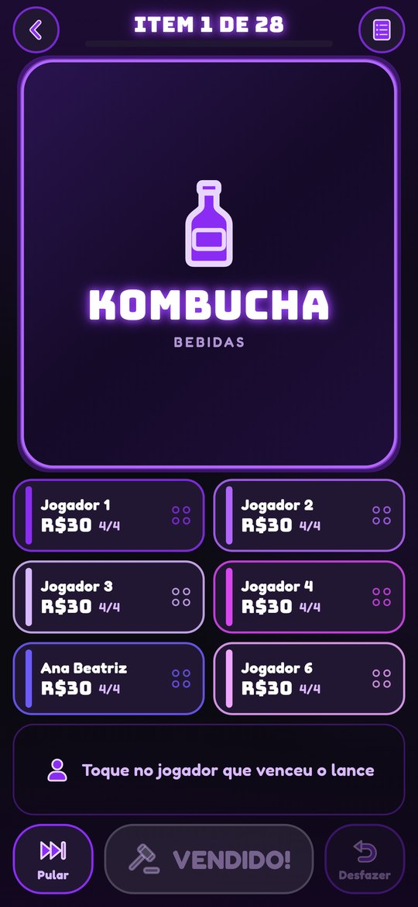
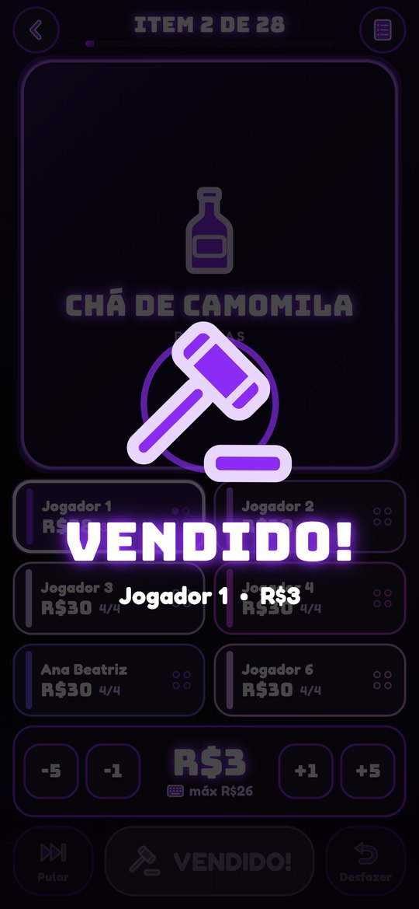
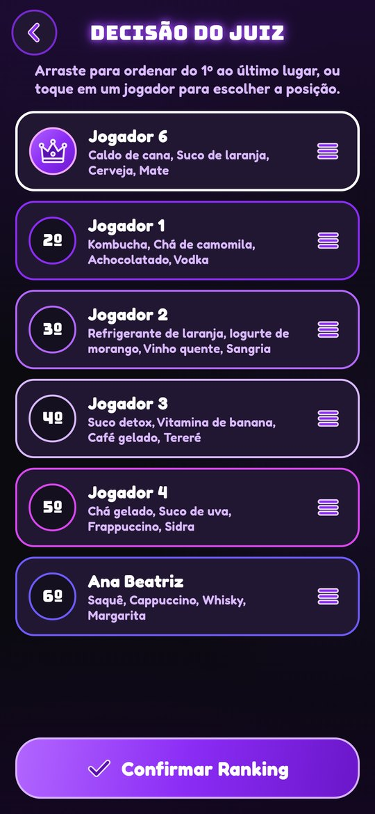
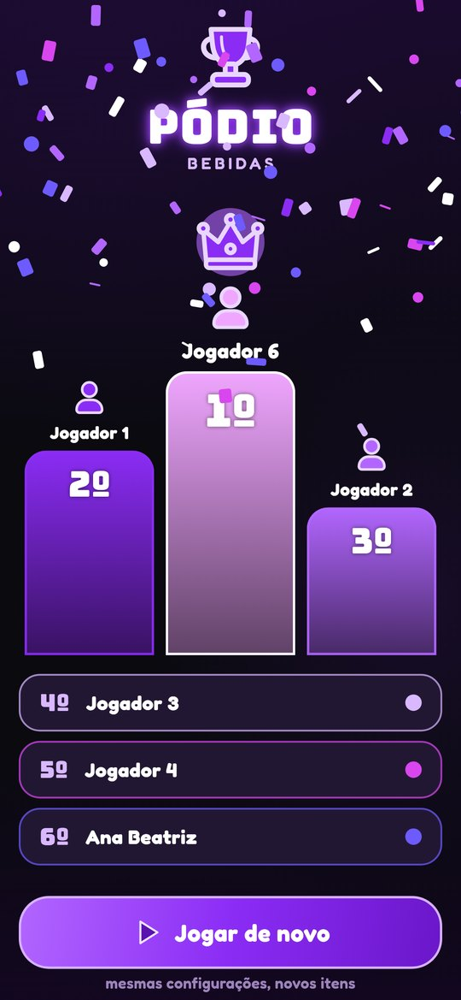

# LANCE!

Jogo de leilão para jogar **presencialmente** com um único celular, passado de mão em mão ou na mão de um leiloeiro.
Os jogadores disputam itens de um tema com dinheiro fictício, cada um monta sua lista e, no fim, um juiz (uma pessoa real) decide o ranking.

100% offline, sem login, sem anúncios. Flutter + Provider + shared_preferences.

<p>





</p>

## Estrutura

```
lib/
  main.dart                 ponto de entrada, providers
  theme/                    cores (roxo e preto), textos (Bungee/Fredoka), tema
  models/                   Player, Purchase, GameConfig, ThemeCategory
  data/themes_data.dart     itens de cada tema (fácil de editar e ampliar)
  state/                    GameController (regras, desfazer, salvamento) e SettingsController
  services/                 sons e vibração
  widgets/                  ícones próprios (CustomPainter), botões com brilho, confete, cards...
  screens/                  menu, temas, tema personalizado, configuração, leilão,
                            revisão, juiz, pódio, como jogar, configurações
assets/fonts/               Bungee e Fredoka (SIL Open Font License), embutidas
assets/sounds/              martelo, moeda, fanfarra, toque (sintetizados por tool/gerar_sons.py)
tool/                       scripts que geram os sons e o ícone do launcher
test/                       regras (todas as combinações) e fluxo completo pela interface
```

## Adicionar itens ou temas

Abra `lib/data/themes_data.dart`. Para mais itens, inclua strings na lista `itens` do tema.
Para um tema novo, copie um bloco `ThemeCategory`, troque `id`, `nome`, `descricao`, `icone` e `itens` (mínimo 40).

## Regras implementadas

- 2, 4 ou 6 jogadores; R$20, R$30 ou R$50; lista de 3 a 6 itens.
- Itens no leilão: padrão = jogadores × lista + 4; mínimo = jogadores × lista; ordem aleatória.
- Lance mínimo R$1, nunca acima do saldo.
- Regra opcional (ligada por padrão): guardar R$1 para cada vaga que ainda falta.
- Jogador com lista completa ou sem dinheiro fica desativado (cinza).
- Fim: todas as listas fechadas, todos sem dinheiro, ou acabaram os itens.
- Desfazer volta a última venda (ou pulo) e devolve o dinheiro.
- A partida em andamento é salva a cada ação e pode ser retomada pelo menu.

## Testes

```
flutter test
```

- `test/game_controller_test.dart`: regras, validações, desfazer, salvamento e simulações aleatórias de
  todas as combinações (2/4/6 jogadores × R$20/30/50 × listas 3–6, com e sem a regra do R$1).
- `test/fluxo_test.dart`: joga partidas completas pela interface (menu → tema → configuração → leilão →
  encerrado → revisão → juiz → pódio → jogar de novo) para 2/4/6 jogadores × R$20/30/50 em três tamanhos de
  tela (360×640, 393×851, 430×932), com as fontes reais, falhando em qualquer estouro de layout.
  Para gerar capturas: `CAPTURAS=1 flutter test test/fluxo_test.dart --plain-name "capturas de tela" --update-goldens`.

## Gerar o APK

```
flutter build apk --release
```

O arquivo fica em `build/app/outputs/flutter-apk/app-release.apk`.
O build de release está assinado com a chave de debug (suficiente para instalar direto no celular).
Para publicar em loja, configure uma chave própria em `android/app/build.gradle.kts`.

### Instalar no celular

1. Copie o `app-release.apk` para o celular (cabo USB, Google Drive, WhatsApp para você mesmo...).
2. Abra o arquivo no celular. Se aparecer o aviso, permita "Instalar apps desconhecidos" para o app que abriu o arquivo.
3. Toque em Instalar. O ícone "LANCE!" aparece na tela inicial.

Ou, com o celular ligado ao computador em modo depuração USB: `adb install build/app/outputs/flutter-apk/app-release.apk`.
